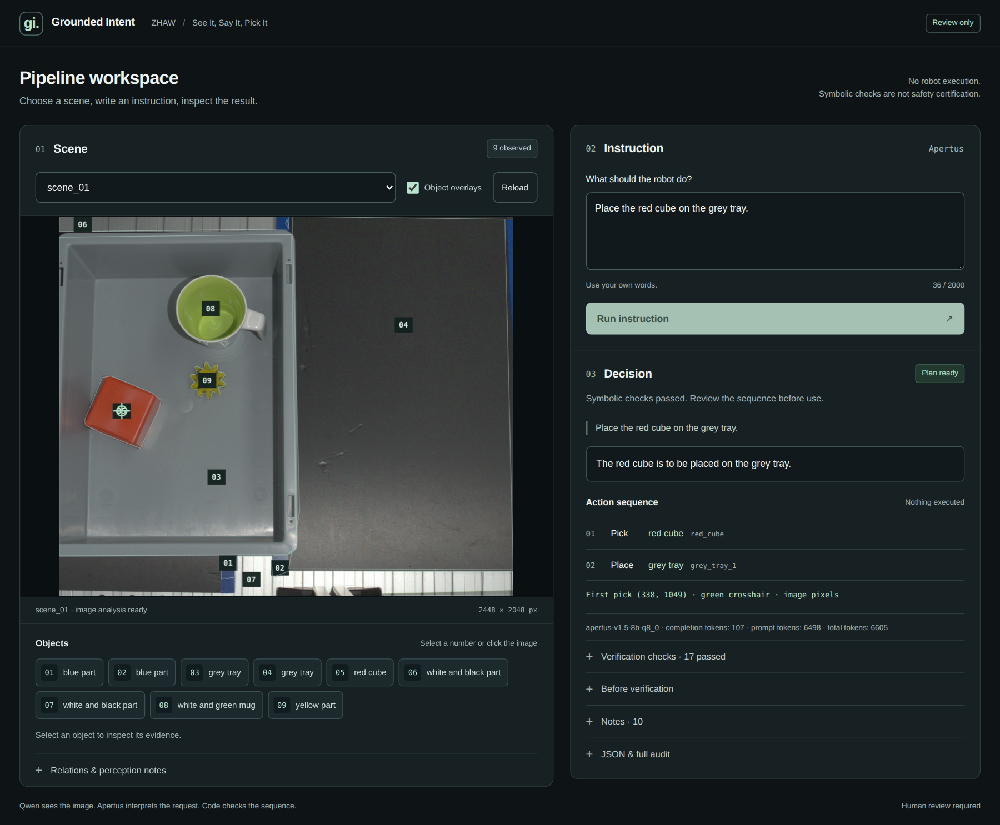

# Grounded Intent

A local vision–language pipeline for **ZHAW’s “See It, Say It, Pick It” challenge at Hack Apertus 2026**.

Give it a workcell photo and an English instruction. It returns a first-pick pixel and an ordered pick/place plan—or asks for clarification or refuses. **Qwen sees the image; Apertus interprets the request; Python compiles and checks the actions.** The browser app lets you inspect each observation and review the resulting plan. It does not control a robot.

The complete local pipeline ran on **one NVIDIA RTX 4070 Ti with 12 GB VRAM**. Perception and language models take turns on the GPU rather than occupying it together.

[Technical report](report/technical_report.pdf) · [Five-slide presentation](report/slides.pdf) · [Development answers](results.json) · [Held-out answers](results_heldout.json)



## Setup

Run the commands below from the repository root.

**Requirements:** Linux, or WSL2 with systemd enabled; Python 3.11 or newer; an NVIDIA GPU and CUDA toolkit; Git, a C++ compiler, CMake and Ninja. The native launcher uses cgroup v2 and a working `systemd-run --user` service for memory isolation. GPU VRAM and host RAM are separate resources.

### 1. Install Python dependencies

```sh
python3 -m venv .venv
. .venv/bin/activate
python -m pip install -r requirements.txt
```

### 2. Download the models

```sh
python scripts/prepare.py
```

This downloads the pinned Apertus and Qwen GGUFs, Qwen’s vision projector, SAM2, YOLOE and its text encoder. Model revisions and filenames are defined in [`assets.py`](src/grounded_intent/assets.py). The preparation step needs network access; the models are not bundled in Git.

The default model directory is `../.models`. SAM2 uses the Hugging Face cache, and the MobileCLIP encoder is prepared in the repository root. Keep those files available for local inference.

### 3. Build the pinned inference server

```sh
git clone https://github.com/ggml-org/llama.cpp ../.tools/llama.cpp
git -C ../.tools/llama.cpp checkout 436f6f89e1e581249900b37a5b8a12a36a6d0912
cmake -S ../.tools/llama.cpp -B ../.tools/llama.cpp/build -G Ninja \
  -DGGML_CUDA=ON -DLLAMA_CURL=OFF -DCMAKE_BUILD_TYPE=Release
cmake --build ../.tools/llama.cpp/build --parallel --target llama-server
```

The launcher uses `../.models` and `../.tools/llama.cpp/build/bin/llama-server` by default. To use existing installations, set `MODELS_DIR` and `LLAMA_SERVER`, or pass `--models` and `--server`. Use the pinned runtime revision for reproduction.

## Run the pipeline

Both datasets are included: `dataset/` contains ten development scenes; `heldout/` contains five held-out scenes. After setup, one command handles perception, language interpretation and action verification:

```sh
# Development scenes
python run.py --data dataset --out artifacts/dev_results.json

# Held-out scenes
python run.py --data heldout --out artifacts/heldout_results.json
```

These commands write separate outputs rather than overwrite the checked-in submission answers. For the organizers’ output filename, use:

```sh
python run.py --data heldout --out results_heldout.json
```

Score development answers with the official evaluator:

```sh
python starter/evaluate.py artifacts/dev_results.json --data dataset
```

For another scene folder, use the same `--data` argument. Each scene must be a subdirectory containing `rgb.png` and `instructions.txt`; see [data conventions](docs/DATA.md) and the [answer schema](schema/result.schema.json).

The inference path reads the scene image and instruction text—not ground-truth masks, category labels or saved answers. Newly computed image observations are cached locally in `.cache/scenes`; no perception cache is shipped. Reusing those observations avoids perceiving the same photo for every instruction. To use a separate cache, pass `--cache /path/to/cache`.

## Use the browser app

```sh
python run.py demo --data dataset --port 8082
```

Open **[http://127.0.0.1:8082](http://127.0.0.1:8082)**. You can also use `--data heldout` or another scene folder.

1. Choose a scene. Numbered overlays match the object buttons; select either to inspect the observation and its evidence.
2. Write an instruction in your own words and select **Run instruction**.
3. Review the decision and action sequence. Expand verification checks, the pre-verification proposal or JSON when you need the details.

An amber crosshair marks the selected observation; a green crosshair marks the proposed first pick. The graspability field is a raw vision-model estimate, not a verified physical grasp.

The app and batch runner share the same pipeline. Stop the app with **Ctrl+C** before starting a batch run: the local model runtime has a single owner. The app binds to loopback by default, and its port is separate from the model server’s default port, `8081`.

## How it works

| Component | Job |
|---|---|
| **Qwen3.5-9B MTP, UD-Q4_K_XL** | Inventories the image without the user’s instruction; close-ups provide additional object structure. |
| **YOLOE-26s + SAM2 hiera-small** | Re-ground observations and refine masks to choose interior pick pixels. |
| **Apertus 1.5 8B, Q8_0** | Extracts instruction semantics, then binds them to observed object IDs or proposes clarification/refusal. Uses non-thinking decoding. |
| **Language and geometry rules** | Correct selected interpretation errors, rank spatial referents and enforce movement restrictions. |
| **Compiler and state verifier** | Order blocker clearing and pick/place actions, then check gripper occupancy, support relations and goal consistency. |

This is a hybrid system: deterministic rules can change Apertus’s proposal. A valid JSON response is not proof that the instruction was understood, and a valid symbolic sequence is not proof of a safe physical execution.

## Results and limits

The saved development answers score as follows under the official [evaluation rules](EVALUATION.md):

| Measure | Saved result |
|---|---:|
| Grounding | **35/35** — 40/40 first-pick pixels |
| Safety-response score | **30/30** — 10/10 correct non-plan responses; 0/40 false asks/refusals |
| Automatic total | **65/65** |

The scorer checks the first pick and the response kind, **not completion of every later action**. One recorded placement request stopped after picking the object because its destination was absent from the observed graph. Full automatic credit therefore does not mean every task was completed.

`results_heldout.json` contains 40 saved answers. The held-out labels are not public, so we report no held-out accuracy. Saved answers describe recorded runs; they are not a guarantee that later code or model changes reproduce identical outputs.

The [two-page report](report/technical_report.pdf) covers the failed structured-parser experiments, prompt-transfer results and model comparisons. Remote CSCS experiments described there are development diagnostics, non-compliant as local submission measurements; they are separate from the local pipeline above.

No robot execution was performed. RGB images do not establish object height, grasp pose or collision-free motion, and symbolic checks are not safety certification. Every proposed action requires human review.

## Development

Install the test dependencies and run the non-model suite:

```sh
python -m pip install -e '.[test]'
python -m pytest -m 'not models'
```

The inference code is in [`src/grounded_intent/`](src/grounded_intent/), the browser interface in [`static/`](src/grounded_intent/static/), and behavioral tests in [`tests/`](tests/). Generated observations, logs and audits stay in ignored local directories.

### Troubleshooting

- **Missing models or server:** complete the preparation/build steps, or check `MODELS_DIR` and `LLAMA_SERVER`.
- **Another run owns the runtime:** stop the other app or batch process before launching a new one. The launcher will not adopt an unrelated inference server.
- **Memory isolation unavailable:** check cgroup v2 and the systemd user service. The native launcher requires memory isolation; do not bypass its guard.
- **Repeated grammar errors in the app:** restart the app. Batch execution already isolates scenes in fresh child processes to contain the observed upstream server fault.

## Licence

Project code: [Apache-2.0](LICENSE). ZHAW benchmark data: **CC BY 4.0**. Third-party libraries and model weights retain their own licences: [Apertus](https://huggingface.co/andreasmartin/apertus-v1.5-8b-text-Q8_0-GGUF), [Qwen](https://huggingface.co/unsloth/Qwen3.5-9B-MTP-GGUF), [SAM2](https://huggingface.co/facebook/sam2.1-hiera-small) and [Ultralytics](https://github.com/ultralytics/ultralytics).
